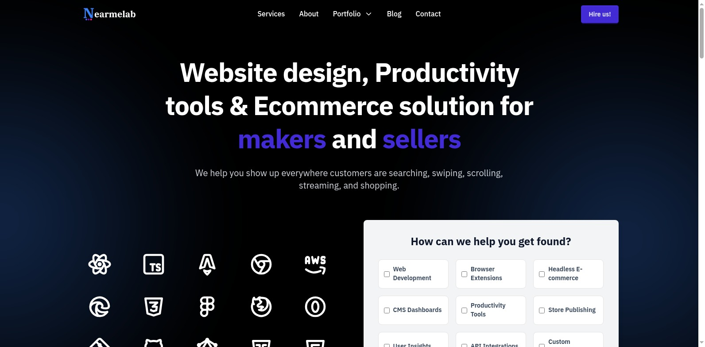

# NearMe



Welcome to the official GitHub presence for **NearMe**! We are a new company passionate about building modern, efficient, and open-source web solutions. Our goal is design Website, Productivity tools & Ecommerce solution for makers and sellers.

## Our Main Open-Source Project: Astroboard

**Astroboard** is our flagship open-source dashboard, built with the powerful Astro framework. It's designed to be lightweight, fast, and customizable.

### Full-Screen Mode


### Compact Mode


## Getting Started with Astroboard

To get a local copy up and running, follow these simple steps:

1.  **Install Dependencies:**
    ```sh
    npm install
    ```

2.  **Run the Development Server:**
    ```sh
    npm run dev
    ```

## License

Our Astroboard project is distributed under the MIT License. See the `LICENSE` file in the project repository for more information.
